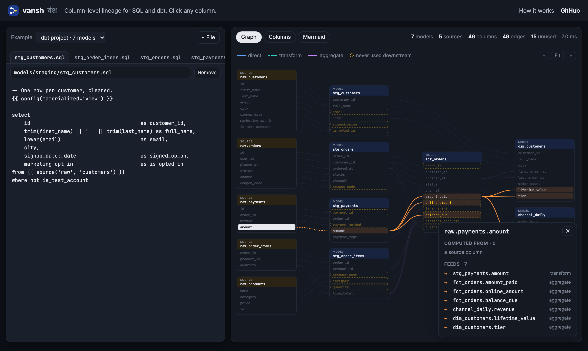

<div align="center">

# vansh

**Column-level lineage for SQL and dbt. Find out where every column comes from, and what breaks if you change it.**

[](https://samarthjaiswal.github.io/vansh/)
[](https://github.com/SAMARTHJAISWAL/vansh/actions/workflows/ci.yml)
[](https://ocaml.org)
[](LICENSE)

<a href="https://samarthjaiswal.github.io/vansh/"></a>

</div>

*Vansh* (वंश) is Hindi for "lineage" or "family line".

**[Try it in your browser →](https://samarthjaiswal.github.io/vansh/)** Edit the SQL and the graph updates as you type.
Click any column to light up everything it is computed from and everything computed from it. The page runs the real
analyzer: the OCaml code compiled to a 150 KB JavaScript file. Your SQL never leaves the tab.

## Why

"Can I rename `amount` in the payments staging model?" is a hard question in any warehouse with more than a few
dozen models. Table-level lineage says *which models* read `stg_payments`. It doesn't say which of their columns
actually depend on `amount`, and which only use `order_id` and would be fine. vansh answers at the column level:

```text
$ vansh impact raw.payments.amount models/
downstream impact (what is computed from this column)
raw.payments.amount
└─ stg_payments.amount (transform)
   ├─ fct_orders.amount_paid (aggregate)
   │  ├─ channel_daily.revenue (aggregate)
   │  ├─ dim_customers.lifetime_value (aggregate)
   │  └─ dim_customers.tier (aggregate)
   ├─ fct_orders.online_amount (aggregate)
   └─ fct_orders.balance_due (aggregate)
```

It needs no warehouse connection and no `dbt compile`. It reads the `.sql` files directly, so it works in a pull
request check before anything is deployed.

## Features

- **Traces through everything that moves a value:** CTEs (including recursive ones), derived tables, correlated and
  scalar subqueries, every join type, `UNION`/`INTERSECT`/`EXCEPT`, `SELECT *` and `t.*` with `EXCLUDE`/`EXCEPT`,
  window functions, `CASE`, `CAST` and `::`, `QUALIFY`, lateral column aliases, `UNNEST`/`FLATTEN`/`LATERAL VIEW`,
  Snowflake `col:path` access, and `INSERT INTO … SELECT` and `CREATE TABLE … AS`.
- **Says how each column is derived.** Every edge is **direct** (passed through or renamed), **transform**
  (computed from it) or **aggregate** (summed, counted, ranked). Columns in `WHERE`, `JOIN … ON`, `GROUP BY`,
  `HAVING` and `QUALIFY` are tracked separately as *row-level* dependencies, because they change which rows
  exist but not any single value.
- **Understands dbt projects:**
  - Models are resolved in dependency order, so `SELECT *` from an upstream model expands to its real columns.
  - `ref()` and `source()` are rewritten to the tables they name.
  - `` blocks keep their first branch; `is_incremental()` counts as false, so you see the full-refresh shape.
  - `` blocks are skipped.
  - Common macros such as `generate_surrogate_key`, `star`, `date_trunc`, `group_by` and `type_*` are understood.
  - An unknown macro used as a value takes its column-name arguments as inputs, e.g. `{{ cents_to_dollars('amount') }}`.
- **Finds dead columns.** `vansh unused` lists columns a model produces that no downstream model reads, as a value or
  as a filter.
- **Works without a schema, more exactly with one.**
  - Without a schema, unknown tables are "open" and vansh warns when an unqualified column could come from more than one table.
  - Pass `--schema warehouse.sql` (plain `CREATE TABLE` statements) to expand `*` over source tables and resolve every column exactly.
- **Tolerates real-world SQL across dialects:** quoted, backticked and `[bracketed]` identifiers, `$$` strings,
  `ILIKE`, `IS DISTINCT FROM`, `FILTER (WHERE …)`, `WITHIN GROUP`, named arguments (`input => x`), time travel,
  `TABLESAMPLE`, `GROUP BY ALL` and `GROUP BY 1, 2`. A statement that fails to parse is reported with its line and
  column, and the rest of the file is still analysed.
- **Output formats:** text, JSON, [Mermaid](https://mermaid.js.org/) (renders directly on GitHub) and Graphviz DOT.

## Tested on real projects

Besides its own suite, vansh was run against three public dbt projects it had never seen:

| Project | Models | Parse errors | Notes |
| --- | --: | --: | --- |
| [dbt-labs/jaffle-shop](https://github.com/dbt-labs/jaffle-shop) | 13 | 0 | lineage traced from the marts back to the raw tables, through a custom `cents_to_dollars` macro |
| [fivetran/dbt_shopify](https://github.com/fivetran/dbt_shopify) | 264 | 0 | heavy macro use: `fill_staging_columns`, inline `{{ "col" if var(...) else 'null' }}` |
| [fivetran/dbt_stripe](https://github.com/fivetran/dbt_stripe) | 69 | 0 | 22 warnings, all for columns generated by `` loops, which vansh does not evaluate |

All 346 models are analysed in **0.06 seconds** on an Apple M3.

## Quick start

There are no binary releases yet; build from source with [opam](https://opam.ocaml.org/doc/Install.html):

```sh
git clone https://github.com/SAMARTHJAISWAL/vansh
cd vansh
opam install . --deps-only
dune build
dune exec -- vansh test/fixtures/dukaan/models
```

Or install it onto your `PATH`:

```sh
opam pin add vansh https://github.com/SAMARTHJAISWAL/vansh.git
```

## Usage

```text
vansh [lineage] [PATH...]           every output column and the columns it is computed from
vansh trace TABLE.COLUMN [PATH...]  upstream: where does this column come from?
vansh impact TABLE.COLUMN [PATH...] downstream: what breaks if this column changes?
vansh unused [PATH...]              columns that are produced but never used downstream
vansh graph [PATH...]               the whole graph as Mermaid (default), DOT or JSON
vansh check [PATH...]               exit 1 on parse errors or lineage warnings (for CI)

  -f, --format FMT    text (default), json, mermaid, dot
  -s, --schema FILE   CREATE TABLE statements describing source tables
      --color WHEN    auto (default), always, never
```

`PATH` is a `.sql` file or a directory, searched recursively. dbt's `target/` and `dbt_packages/` are skipped.
With no path, vansh reads SQL from standard input:

```text
$ echo "select o.id, o.amount * 1.18 as with_tax, sum(p.paid) as paid
        from orders o join payments p on p.order_id = o.id group by 1, 2" | vansh
query  <stdin>
  id        <- orders.id
  with_tax  <- orders.amount transform
  paid      <- payments.paid aggregate
  rows filtered or grouped by: orders.amount, orders.id, payments.order_id
```

A model is named after its file (the dbt convention), or after the target of `CREATE TABLE … AS` / `INSERT INTO`.
`TABLE.COLUMN` arguments can use a table's short name: `orders.amount` finds `raw.orders` if it is unambiguous.

### In CI

```yaml
- run: vansh check models/                   # parse errors or ambiguous columns fail the job
- run: vansh impact stg_payments.amount models/ >> "$GITHUB_STEP_SUMMARY"
- run: vansh graph models/ > docs/lineage.mmd
```

## How it works

```
 .sql files ─▶ Jinja pass ─▶ lexer ─▶ recursive-descent parser ─▶ AST
              (ref/source,                                          │
               if-blocks,                         dependency order  ▼
               macros)          models resolved upstream-first ─▶ scope resolver ─▶ lineage graph
                                                                                    │
                                    text · JSON · Mermaid · DOT · browser ◀─────────┘
```

1. **Parsing.** A hand-written lexer and recursive-descent parser, with precedence climbing for expressions, cover
   the parts of SQL that can move a value between columns. Anything that can't (type names, window frames, hints,
   `LIMIT`) is skipped with balanced-bracket scanning, which is why it copes with so many dialects. There are no
   parser-generator or runtime dependencies; the library uses only the OCaml standard library.
2. **Scopes.** Every relation in scope (base table, CTE, subquery, upstream model, table function) becomes an ordered
   list of columns, each with the set of external columns it depends on. Resolving a `SELECT` composes those sets,
   so lineage flows through any depth of nesting and comes out pointing at tables outside the statement.
   Unqualified names are resolved the way the database would: first `FROM` items that are known to have the
   column, then earlier select-list aliases, then outer queries (for correlated subqueries).
3. **Open tables.** A table without a known schema is *open*: any column can be read from it, and `SELECT *` from it
   becomes a `*` passthrough that later reads look through, renaming as they go. That is how
   `with s as (select * from raw.orders) select id as order_id from s` still traces `order_id` to `raw.orders.id`.
4. **Projects.** Files are parsed, models are topologically sorted by what they read (cycles are reported, not
   fatal), and each resolved model joins the catalog before its consumers are resolved.
5. **Queries.** `trace`, `impact` and `unused` are walks over the resulting column graph.

The browser demo compiles the same library with [js_of_ocaml](https://ocsigen.org/js_of_ocaml/). The page only adds the editor and the graph
layout: columns by dependency depth, and barycenter ordering to reduce edge crossings.

## Alternatives

Column lineage is an established problem, and you may already have a tool for it. Here is how they compare:

| Tool | Reach for it when | How vansh differs |
| --- | --- | --- |
| [**sqllineage**](https://github.com/reata/sqllineage) | You want a mature Python library and CLI with a web visualizer. | Similar goal. vansh adds dbt-aware project resolution (`ref`, ordering, `*` across models), `impact`/`unused`, and runs in the browser without a server. |
| [**sqlglot**](https://github.com/tobymao/sqlglot) `lineage` | You are in Python and want a full SQL parser, optimizer and transpiler for dozens of dialects. | sqlglot is far broader. vansh does one job, is dbt-aware out of the box, and needs no Python runtime. |
| dbt Explorer (dbt Cloud) | You use dbt Cloud and want lineage tied to your deployed project and docs. | That is a hosted dbt Cloud feature built on compiled manifests. vansh is free, local and works on raw files in a PR. |
| [**DataHub**](https://github.com/datahub-project/datahub), [**OpenMetadata**](https://github.com/open-metadata/OpenMetadata) | You want an organisation-wide catalog with lineage across warehouses, BI tools and pipelines. | Those are platforms to deploy. vansh is a single command for the SQL in front of you. |
| [**OpenLineage**](https://github.com/OpenLineage/OpenLineage) | You want lineage emitted at run time by your orchestrator. | Run-time lineage sees what actually ran. vansh is static: it sees what the code says, before it runs. |

## Limitations

- vansh does not run Jinja. Columns generated by `` loops or custom macros are reported as warnings, not
  guessed. `` keeps the first branch only.
- Without a schema, an unqualified column in a multi-table query that vansh cannot place is attributed to every
  candidate table, with a warning. Qualify the column or pass `--schema` to make it exact.
- `PIVOT`/`UNPIVOT`, `MERGE` and stored procedures are not traced yet.
- Name matching is case-insensitive, so quoted identifiers that differ only in case are treated as the same column.

## Development

```sh
dune build          # library, CLI and (if js_of_ocaml is installed) the browser bundle
dune test           # 100+ unit tests plus CLI cram tests (test/cli.t)
./web/build.sh      # browser demo into _site/ (needs js_of_ocaml)
```

`test/fixtures/dukaan/` is a small dbt project (a fictional Indian D2C store) used by the tests and the demo.
CI runs the suite on Linux and macOS with OCaml 5.2 and 5.5, builds the browser bundle, and checks that it gives
the same answer as the CLI.

## License

[MIT](LICENSE)
